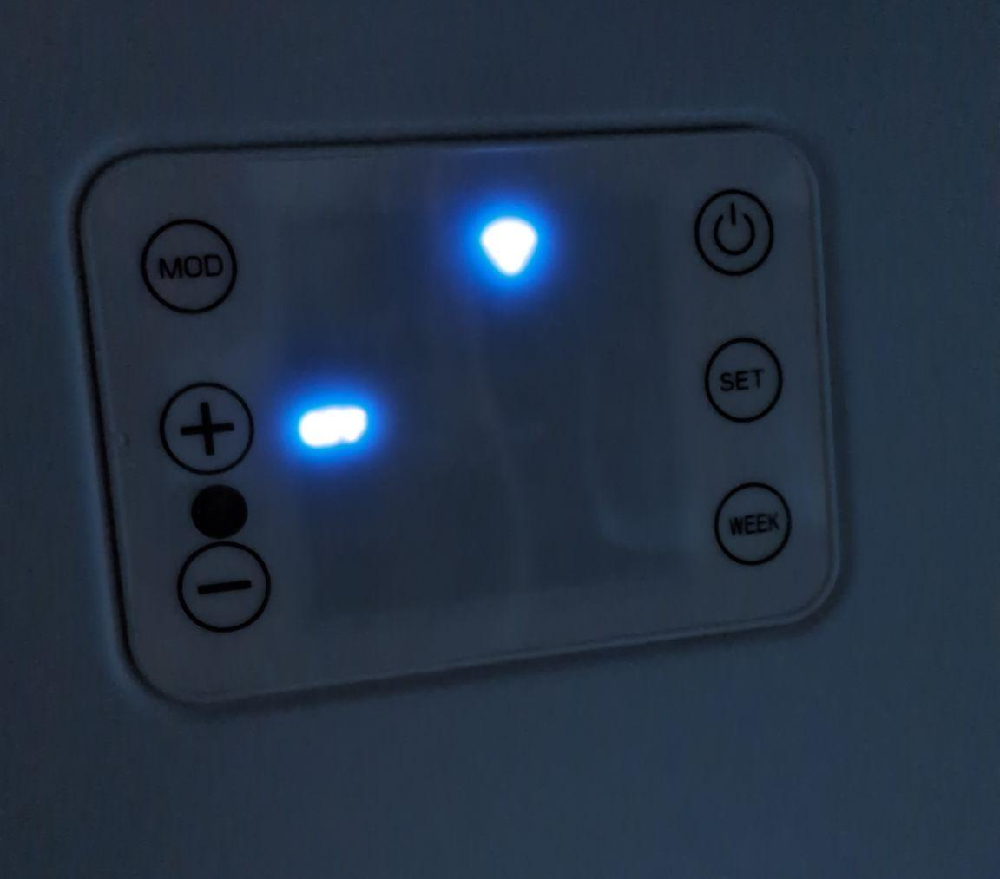
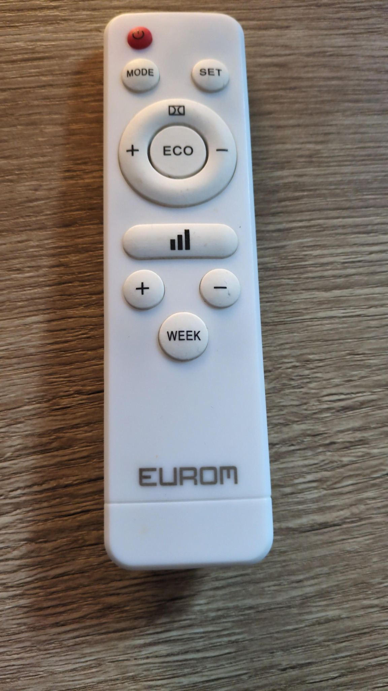

# Eurom Mon Soleil DSP for ESPHome

Local Home Assistant control of a **Eurom Mon Soleil DSP 400 WiFi** infrared heater, using ESPHome and the heater's existing Tuya MCU protocol.

**Experimental: maintainer testing is in progress.** The supplied YAML records observations from one 400 W unit. Other variants are candidates for testing, not confirmed compatible devices. This is an ESPHome configuration, not a Home Assistant custom integration or a HACS package.

Home Assistant communicates with ESPHome through its native API; ESPHome exchanges UART messages with the heater's control MCU. The MCU remains responsible for the heater controls. Its safety behavior after modification has not been independently verified.

## Current scope

This project provides configuration and operating notes for a suitable device **already running ESPHome with a verified MCU connection**. It is not yet a complete stock-to-ESPHome conversion guide. Factory firmware backup/restoration, initial flashing, module identification and the internal four-pin connector pinout are still [TODO](TODO.md). Do not infer a wiring or flashing procedure from the YAML.

This is a mains-powered heater. Internal work must be performed by a competent, qualified person with the appliance disconnected and made safe. Do not connect a computer/programmer to potentially mains-referenced electronics. Follow the manufacturer's placement and operating instructions, keep the heater uncovered and supervise experimental operation. Home Assistant availability, a fault sensor reading of zero and a successful software build are not safety guarantees.

## Models and compatibility

| Model | Article number | Status |
| --- | --- | --- |
| DSP 400 WiFi, 400 W | 361896 | Base model family; maintainer testing one 400 W unit; confirm its label/article number and hardware revision |
| DSP 650 WiFi, 650 W | 361919 | Untested candidate |
| DSP 770 WiFi, 770 W | 361933 | Untested candidate |
| DSP 400 WiFi, 400 W, Swiss plug | 361902 | Untested candidate |
| DSP 650 WiFi, 650 W, Swiss plug | 361926 | Untested candidate |
| DSP 770 WiFi, 770 W, Swiss plug | 361940 | Untested candidate |

Article numbers identify the product family, not verified electronics. Check the module, flash size, PCB revision, UART and datapoints before adapting this configuration. Do not assume all Mon Soleil, DSP Frame or similarly named models use the same hardware.

## Exposed entities

| Entity | Function / limitation |
| --- | --- |
| Eurom heater | Power, target temperature and current temperature; heating/idle indication from DP101 |
| Eurom mode | Manual (M) or Thermostat (P); this is separate from the climate card's Heat/Off selection |
| Eurom heating element | Writable DP101 select: On/Off; observed manual control in M mode; interaction with P mode needs testing |
| Eurom ECO (16 °C) | Fixed 16 °C ECO mode, as observed by the maintainer |
| Eurom room temperature | Additional standalone sensor using the same DP3 value as the climate entity |
| Eurom fault code | Raw DP12 value; fault bit meanings are not decoded or verified |
| ESP IP Address / SSID / BSSID / MAC | Network diagnostics; redact these values from public logs/screenshots |

The board (`esp01_1m`), RX GPIO13, TX GPIO15 and 9600 baud are retained from the maintainer's source YAML. They are not a verified connector diagram or evidence that every production unit contains the same module.

## Setup in ESPHome Device Builder

1. Back up your current **local ESPHome YAML and secrets** before editing. This is separate from the factory flash-backup procedure, which is not documented yet. If the heater is still on stock firmware, stop here until a verified conversion guide is available.
2. Use ESPHome **2026.10.1** for the documented validation baseline. The encrypted OTA syntax requires ESPHome 2026.9.0 or later; older versions are not covered by this example.
3. Copy [eurom-400-wifi.yaml](eurom-400-wifi.yaml) to the Device Builder configuration directory, normally `/config/esphome/`. Keep an existing device's node name and encryption key when updating it. For an additional heater, choose a unique `esphome.name`, `friendly_name` and fallback AP SSID, and use a distinct device key and AP password.
4. Merge the entries from [secrets.example.yaml](secrets.example.yaml) into your local `secrets.yaml` in the same directory. Do not overwrite an existing secrets file or reuse the example credentials.
5. For a new device, generate a 32-byte base64 key with `openssl rand -base64 32`. Set a unique fallback AP password of 8-63 characters. For an existing device, retain its current API/OTA key: a new key in the uploader config alone will not rotate the installed key and can prevent updates.
6. Review the GPIO, board and datapoint assumptions against your already verified installation. Validate the configuration, then compile it in Device Builder. A passing validation is not a successful firmware build. Check flash/OTA size limits for the 1 MB target before installing.
7. Only update a known working ESPHome installation through its established update path. The example requires encrypted OTA. If the installed firmware does not yet offer it, follow the [official OTA migration procedure](https://esphome.io/components/ota/esphome/#enabling-encryption-on-an-existing-device), retaining the existing key/password as directed. No initial flashing procedure is provided here.
8. In Home Assistant, use the discovered ESPHome integration, or add **ESPHome** under **Settings → Devices & services → Add integration** using the device hostname/IP and API key. Confirm the entities and state feedback before operating the heater. See the [official integration documentation](https://www.home-assistant.io/integrations/esphome/).
9. In a supervised session, select **Thermostat (P)** for temperature regulation, then exercise Heat/Off and temperature changes and compare the physical display and logs. Use [TESTING.md](TESTING.md) to record results. Set the Home Assistant area locally if wanted.

If mDNS does not resolve across your VLANs, add `wifi.use_address` to your **private local copy** with the actual reachable IP/hostname. It changes the address used by ESPHome tools; it does not configure a static device IP. Keep that address out of pull requests.

## Operating details and known limitations

- **M is manual heat control.** Changing the climate setpoint does not make it thermostatic. On the original controls, the remote's bars button or the panel's +/− buttons control heat in M mode. Do not use a climate temperature display as evidence that temperature regulation is active.
- **P is thermostat/program mode.** Select it explicitly for setpoint regulation. The climate card's Heat action does not select DP4/P mode. Existing weekly schedules can interact with this mode.
- **DP101 is not just telemetry.** ESPHome 2026.10.1's Tuya climate implementation writes `heating_value` to the active-state datapoint when Heat is selected. Here that can send DP101=0, in addition to DP1=true. The separate element select also writes DP101. The mapping is preserved from the source; verify Heat/Off, M/P and ECO combinations before relying on it. Source: [Tuya climate implementation at the validation version](https://github.com/esphome/esphome/blob/2026.10.1/esphome/components/tuya/climate/tuya_climate.cpp).
- **Open-window detection is not exposed.** No changed Tuya datapoint was seen in the maintainer's tests. This is an observation, not proof that the firmware can never report it.
- **Weekly timer editing is not implemented.** The original manual describes separate local/app timers and retained settings. What remains active after replacing the Wi-Fi firmware has not been established. Do not assume old schedules have been cleared or that ESPHome reproduces the stock app timers.
- Home Assistant time is supplied through `time.homeassistant` and `tuya.time_id`; confirm day/time and behavior after cold start or lost HA connectivity. This does not implement a weekly scheduler.
- Replacing the stock Wi-Fi firmware removes its original cloud/app client; do not expect the Eurom Smart app to keep working. Panel and remote behavior still need the documented regression tests.
- A lost Wi-Fi/API connection is **not an automatic heater-off mechanism** in this YAML. The controller may retain its last state. No claim is made about boot/reboot restoration, heating cut-off or factory safety protections after modification. ESPHome networking/API defaults can also reboot the ESP; test recovery under supervision.
- The room sensor near the panel may differ from the room's ambient temperature. The stock manual describes an external probe; behavior with that probe has not been verified with this project.

## Photos

Photographs supplied by the maintainer show the controls of the test unit; they do not establish its internal hardware revision.

## Project notes

- [Datapoint evidence and unknowns](DATAPOINTS.md)
- [Hardware test checklist and software validation record](TESTING.md)
- [Backup, flashing, connector and compatibility TODO](TODO.md)
- [Changes made when preparing the public example](CHANGELOG.md)
- [Contribution instructions](../../CONTRIBUTING.md) and [AI instructions](../../AGENTS.md)

## References and credits

- [Eurom product page](https://eurom.nl/product/permanente-verwarming/infrarood-verwarming/mon-soleil-dsp-400-wifi/) and [manufacturer manual/downloads page](https://eurom.nl/nl/manuals/). The supplied manual's English section, pages 48-63, was consulted for original operating behavior; no copy of the PDF is included in this repository.
- [ESPHome Tuya MCU](https://esphome.io/components/tuya/), [Tuya climate](https://esphome.io/components/climate/tuya/) and [encrypted OTA](https://esphome.io/components/ota/esphome/).

Developed and maintained by [Graham van der Wielen](https://github.com/grayum). Created with assistance from ChatGPT & Codex (OpenAI). Independent community project; not affiliated with Eurom. See the repository [MIT License](../../LICENSE).
